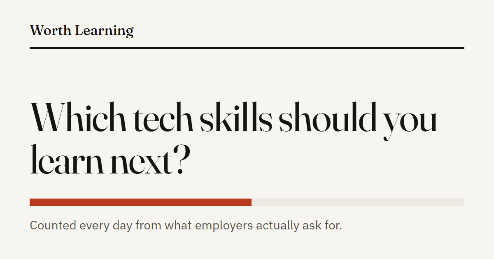
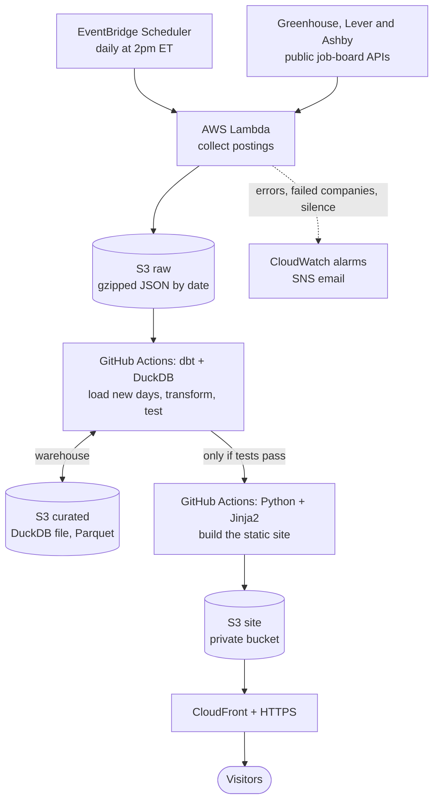

# Worth Learning

**Which tech skills should you learn next?** [worthlearning.dev](https://worthlearning.dev) reads the public job boards of 37 companies every day and counts what employers actually ask for, across nine kinds of technical role.

[](https://worthlearning.dev)

I built this as an MSIS student looking for work in tech. It's also a portfolio project: one small system that covers data engineering, analytics, and running something reliably in production. The repo is called `job-market-pulse` because that was the project's first name.

## How it works



All of the AWS parts are defined in Terraform. GitHub Actions signs in to AWS with short-lived OIDC credentials.

1. **Collect.** A Lambda function pulls about 13,000 postings a day and stores them untouched. If one company's board fails, the run records it and carries on.
2. **Transform.** dbt and DuckDB clean the text, assign a role from the job title, match 105 skills with regex patterns, and count each role once even if it's listed in 15 cities. Only days the warehouse hasn't seen get loaded.
3. **Test.** 22 data tests run on every build. If one fails, nothing is published and the last good site stays up.
4. **Publish.** A small Python script renders plain HTML with no JavaScript, served through CloudFront over HTTPS.

## Decisions worth explaining

- **Keep the raw data forever.** You can't go back and collect yesterday's job boards, but everything downstream can be rebuilt from raw with `dbt build --full-refresh`.
- **One bad board doesn't fail the run.** A failed Lambda would be retried by AWS, re-fetching all 37 companies. Failures go in a run manifest and a metric that has its own alarm instead.
- **An alarm that watches for silence.** A broken schedule produces no errors because nothing ran, so one alarm fires if no run has succeeded in 26 hours.
- **Rank by percentage points, not ratios.** Ratios favor rare skills: for SRE roles they put Argo first (about 10x the overall rate), while points put Kubernetes first (60% of SRE roles against 21% of all tech roles). The second answer is more useful to someone deciding what to learn.
- **Report % of roles and % of companies.** One employer makes up about 19% of postings, so counting companies as well keeps a single big board from deciding the answer.
- **A static site, not an app.** There's no server or database to run, so it's cheap and has little that can break.
- **No stored AWS keys.** GitHub Actions gets short-lived credentials through OIDC, and only this repo's `master` branch qualifies. The Lambda can only write to two prefixes in the raw bucket and can't read or delete, so a bug can't wipe the history.

## What it can't tell you

- **It isn't the whole job market.** These are mostly tech, AI and defense companies. Many large employers use Workday, which has no clean public API, so they're missing. I don't scrape LinkedIn or Indeed.
- **A mention isn't a requirement.** "Nice to have" counts the same as "must have".
- **Matching isn't perfect.** I spot-checked about 200 random samples and estimated 85–90% were right. That's a rough check of precision, and recall hasn't been measured.
- **Roles come from titles only,** so vague titles like "Staff Engineer" aren't counted.

The [How this works](https://worthlearning.dev/methodology/) page has the full list.

## Running it locally

You need Python 3.13. No AWS account is needed for this path: without `RAW_BUCKET` set, data is written to `data/`.

```bash
python -m venv .venv
source .venv/bin/activate        # Windows: .venv\Scripts\Activate.ps1
pip install -r requirements-dev.txt

python -m ingest.run             # collect today's postings, about 1-3 minutes
mkdir data/warehouse
dbt build --project-dir transform --profiles-dir transform
python site/build.py
python -m http.server 8000 -d build/site
```

The site is then at http://localhost:8000. To change what's tracked, edit `config/companies.yaml` and run `python scripts/companies_to_seed.py`, or edit the rules in `transform/seeds/`.

## What's where

| Path | What it holds |
|---|---|
| `ingest/` | The collector: one module per job board, plus S3 or local storage |
| `config/companies.yaml` | The companies being tracked |
| `transform/` | dbt models, tests, and the role and skill rules (`seeds/`) |
| `site/` | Site generator, templates and CSS |
| `infra/` | Terraform for all the AWS resources |
| `.github/workflows/` | The daily build |
| `scripts/` | Packaging, moving the warehouse to and from S3, sampling for review |

## Cost

AWS has billed $0 so far, on a free plan. I estimate under $1 a month after that, mostly S3 storage, plus the domain. There's no NAT gateway, no KMS keys and no always-on server, and budget alerts are set at $1 and $5.

## What's next

Salary data, a US-only filter, and trends once there's enough history.

## License

[MIT](LICENSE)
